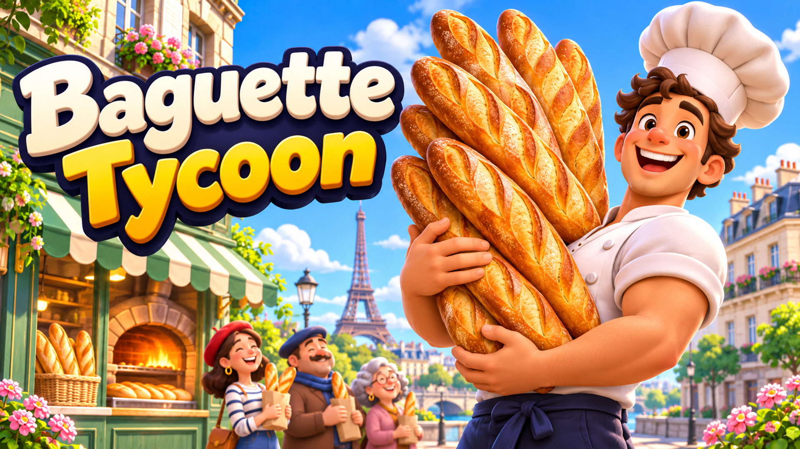

**Baguette Tycoon** is a 3D arcade management game set in a Parisian bakery, built in **JavaScript** with **Three.js**.

Make dough, bake fresh bread, serve customers and turn a small shop into a bakery with its own bakehouse and cafe terrace.

## Gameplay

- **Bake and deliver.** Turn dough into baguettes, croissants and pains au chocolat, then restock the counters.
- **Expand the bakery.** Unlock production equipment, a bakehouse, cakes and a terrace serving coffee and pastries.
- **Hire a team.** Bakers handle deliveries, waiters serve tables and cleaners keep the terrace ready for new guests.
- **Improve your routine.** Upgrade production speed, selling prices, carrying capacity and movement speed.
- **Complete missions.** Earn rewards, gain levels and unlock character outfits.
- **Start another bakery.** Finish the expansion to restart with a revenue bonus while keeping levels and outfits.

## Controls

| Action | Keyboard / mouse | Touch |
| --- | --- | --- |
| Move | WASD, ZQSD, arrow keys, or click and drag | Drag the joystick |
| Collect, deliver, buy or clean | Stand on the corresponding floor zone | Stand on the corresponding floor zone |
| Open missions, upgrades or settings | Click the HUD button | Tap the HUD button |

## Languages

English, French, Spanish, Portuguese, German and Italian. The language can be changed in settings.

## Project layout

| Directory | Purpose |
| --- | --- |
| `src/` | Gameplay, interface and rendering |
| `public/` | Runtime models, loading artwork, sounds and attribution |
| `marketing/covers/` | Approved landscape, portrait and square images |
| `marketing/videos/` | Final landscape and portrait videos |
| `tools/` | Maintainer checks, asset generators and recording tools |
| `docs/` | Maintainer documentation |
| `.github/` | Contribution policies, issue templates and automated checks |

## Feedback

Use GitHub Issues for reproducible bugs, balance feedback and feature suggestions. Please read the [contribution guidelines](.github/CONTRIBUTING.md). Security concerns should follow the [security policy](.github/SECURITY.md).

## Credits

Original characters, bakery props, procedural models and interface artwork are combined with credited third party resources. See [CREDITS.md](CREDITS.md) for provenance and license details.

## License

This repository is public for demonstration purposes. The game and its original source and assets are **All Rights Reserved**. Publication of the source does not grant permission to redistribute or host the game. See [LICENSE](LICENSE). Third party resources retain their respective licenses.
